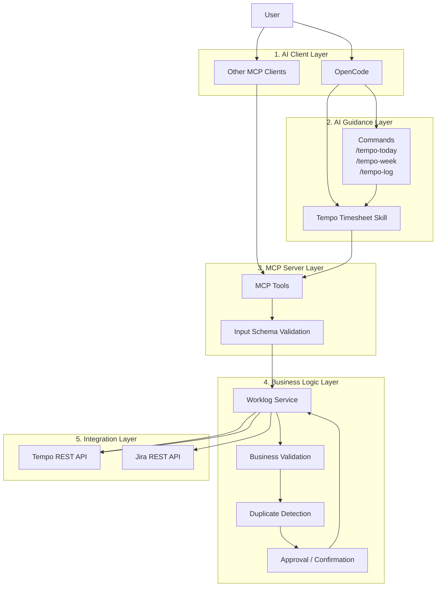

# Kiến trúc hệ thống

Hệ thống gồm 5 lớp chính:

1. **AI Client Layer** — OpenCode hoặc MCP client khác.
2. **AI Guidance Layer** — Skill và Commands hướng dẫn cách thực hiện công việc.
3. **MCP Server Layer** — Cung cấp các tools cho AI agent.
4. **Business Logic Layer** — Validation, kiểm tra trùng lặp và quản lý quy trình.
5. **Integration Layer** — Kết nối Tempo REST API và Jira REST API.

## Luồng tổng quát

## Lưu ý về triển khai

Đây là kiến trúc logic. Trong thực tế:

- Skill và Commands không trực tiếp gọi API; chúng hướng dẫn AI agent gọi MCP tools.
- Với MCP qua stdio, server thường chạy như một tiến trình con của client.
- Việc xác nhận thao tác ghi cần được thực thi trong đúng luồng tương tác của client, thay vì giả định rằng một hộp thoại xác nhận sẽ tự xuất hiện từ MCP Server.
