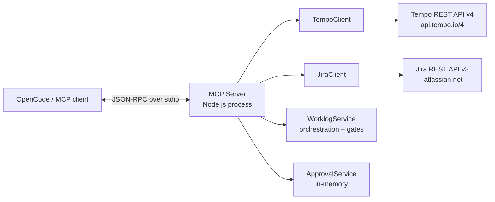
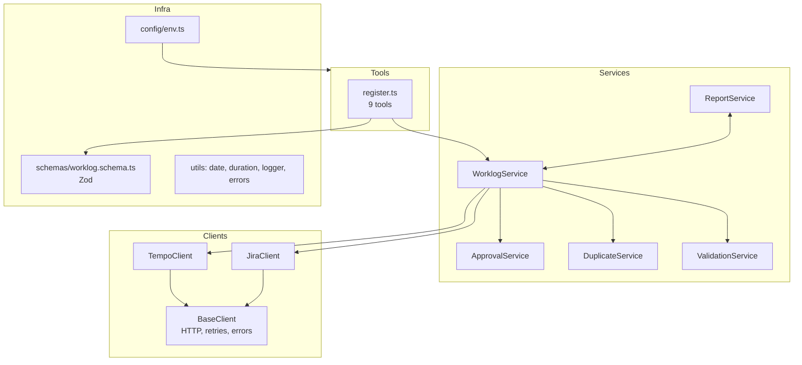
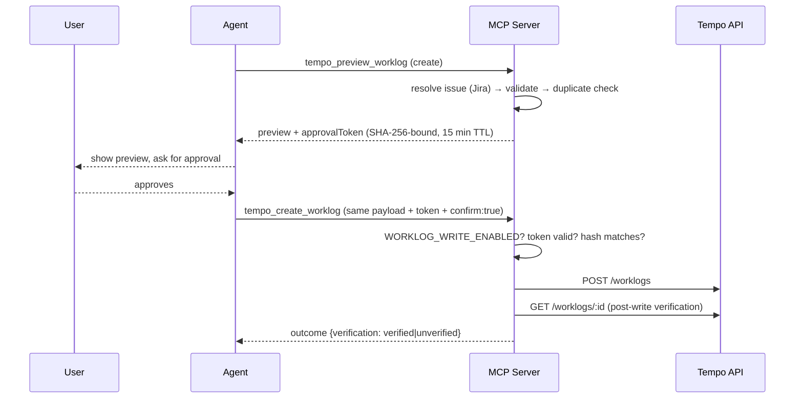

# Architecture

Tempo Timesheet MCP Server — a local stdio MCP server that gives coding agents
safe, read-first access to Tempo Timesheets and (optionally) Jira Cloud.

## High-level view



The server runs on the user's machine. Credentials live in the environment
(`.env`), never in logs or tool output. The only transport is stdio; there is
no network listener.

## Layering



Rules between layers:

- **Tools never call clients directly.** They call services, which own the
  workflow invariants (preview → approval → write).
- **Clients are dumb HTTP wrappers.** They know one API each, map transport
  errors to typed errors, and never enforce business policy.
- **Schemas (Zod) are the single source of truth** for tool input validation.

## Request flow: write path (the important one)



Safety invariants implemented in `WorklogService`:

1. A preview never writes.
2. A successful validation is not an approval — writes additionally require
   `WORKLOG_WRITE_ENABLED=true`, `confirm: true`, and a valid approval token.
3. The approval token is bound to the SHA-256 hash of the exact payload. Any
   change (issue, date, duration, description, startTime) invalidates it.
4. Uncertain outcomes (timeout / network failure on POST/PUT) surface as
   `UNCERTAIN_OUTCOME` and are never retried by the server.
5. No delete operation exists.

## Error model

| Code                        | Meaning                                   | Retry?                   |
| --------------------------- | ----------------------------------------- | ------------------------ |
| `VALIDATION_ERROR`          | Bad input / 400 from API                  | No                       |
| `AUTH_ERROR`                | 401/403 — token or permission problem     | No                       |
| `NOT_FOUND`                 | 404                                       | No                       |
| `RATE_LIMITED`              | 429 (retried internally with Retry-After) | Auto (GET only)          |
| `NETWORK_ERROR` / `TIMEOUT` | Transport failure on reads                | Auto (GET only)          |
| `UNCERTAIN_OUTCOME`         | Write may or may not have landed          | **Never — verify first** |
| `WRITE_DISABLED`            | `WORKLOG_WRITE_ENABLED=false`             | N/A                      |
| `APPROVAL_REQUIRED`         | Missing/expired/mismatched approval token | Re-preview               |
| `CONFIG_ERROR`              | Missing configuration                     | N/A                      |

## Module map

```
src/
├── index.ts              # entry: dotenv, config, stdio server
├── config/env.ts         # AppConfig (Tempo, Jira, timezone, writeEnabled)
├── clients/
│   ├── base-client.ts    # shared fetch: timeout, retry (GET only), error mapping
│   ├── tempo-client.ts   # Tempo v4 (Bearer auth, envelope pagination)
│   └── jira-client.ts    # Jira v3 (Basic auth, /search/jql, nextPageToken)
├── services/
│   ├── worklog-service.ts     # orchestration + write gates
│   ├── approval-service.ts    # token issuance + payload-hash binding
│   ├── duplicate-service.ts   # confidence-scored duplicate detection
│   ├── validation-service.ts  # calendar/date/duration validation
│   └── report-service.ts      # day/issue aggregation
├── tools/                # 9 tool registrations, thin
├── schemas/              # Zod tool input schemas
└── utils/                # date, duration, logger, errors
```
