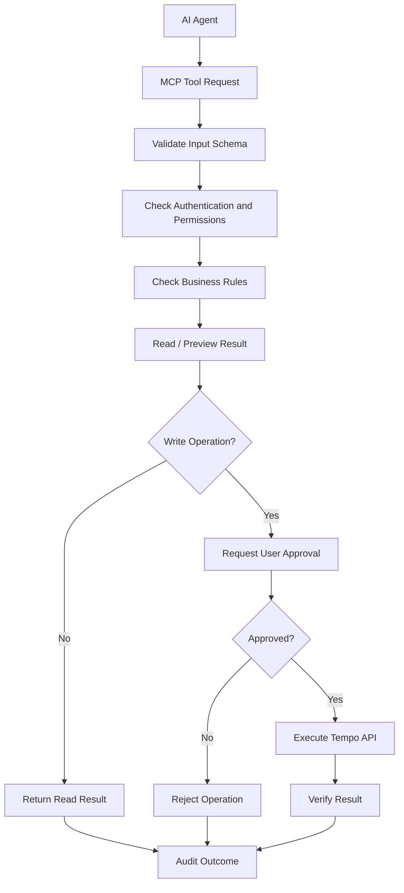

# Security Architecture — Bảo mật và kiểm soát dữ liệu

Vì MCP này có quyền ghi timesheet của công ty, hệ thống nên được triển khai theo nguyên tắc: **Read by default, Write with approval**.

## Luồng xử lý bảo mật

## Các lớp bảo vệ cần có

| Lớp                 | Yêu cầu                                                                   |
| ------------------- | ------------------------------------------------------------------------- |
| Authentication      | Sử dụng Tempo API token hợp lệ                                            |
| Authorization       | Chỉ thao tác trong phạm vi quyền được cấp                                 |
| Input validation    | Kiểm tra issue key, ngày, thời lượng và mô tả                             |
| Duplicate detection | Cảnh báo worklog có khả năng trùng                                        |
| Approval            | Yêu cầu xác nhận trước khi ghi                                            |
| Audit               | Ghi lại thao tác thành công hoặc thất bại, không ghi token                |
| Error handling      | Không tự động gửi lại thao tác ghi khi chưa xác định được kết quả lần đầu |
