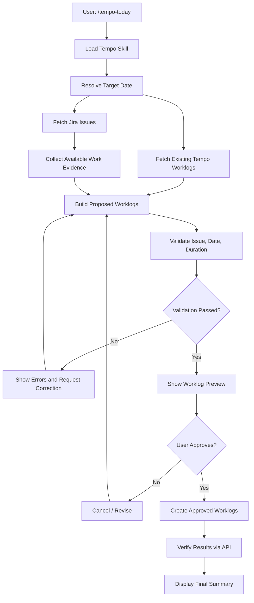
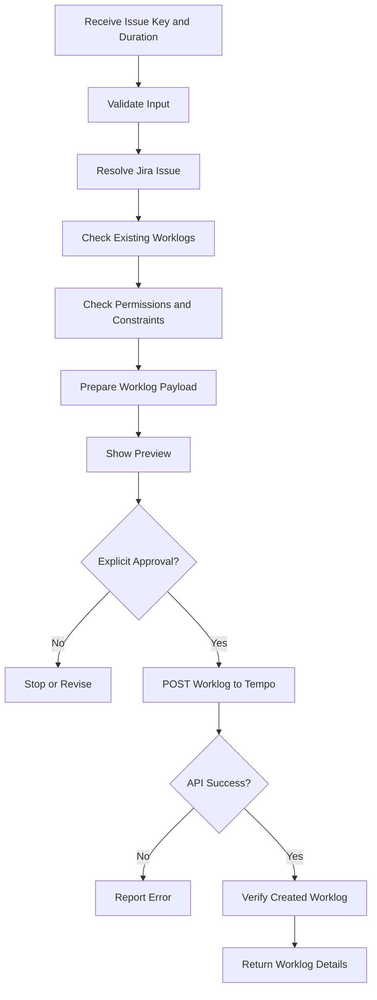
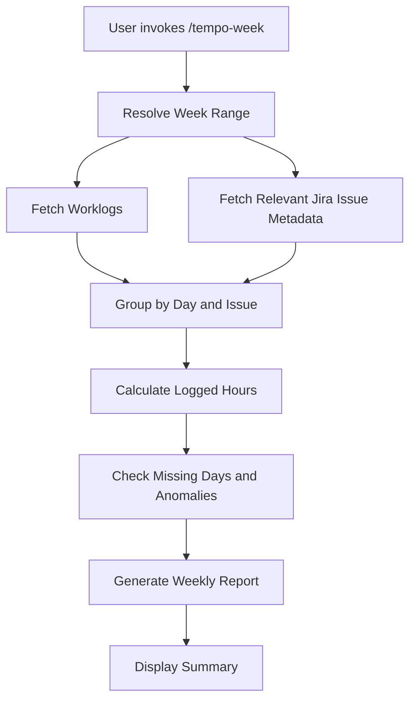
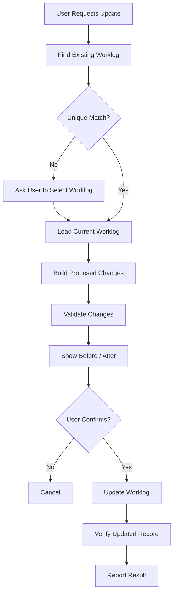

# Workflows

## Workflow A — Tổng hợp công việc trong ngày

Lệnh gọi: `/tempo-today`



**Mục tiêu:** lấy dữ liệu thực tế, tổng hợp công việc và chuẩn bị worklog để người dùng duyệt.

### Ví dụ thực tế

Bạn nhập:

```text
/tempo-today
```

Agent lấy các issue liên quan và worklog đã ghi trong ngày, sau đó trình bày bản tổng hợp:

| Issue       | Mô tả                  | Thời lượng đề xuất |
| ----------- | ---------------------- | ------------------ |
| SP0168-3839 | Implement UI component | 2h                 |
| SP0168-3840 | Fix validation logic   | 1h 30m             |
| SP0168-3842 | Review pull request    | 45m                |
| **Tổng**    |                        | **4h 15m**         |

> **Lưu ý:** Đây chỉ là dữ liệu minh họa, không phải dữ liệu lấy từ Jira của bạn.

Agent phải phân biệt rõ:

- Thời gian đã được ghi nhận trên Tempo.
- Thời gian được suy ra từ dữ liệu có sẵn.
- Thời gian do người dùng cung cấp.
- Thời gian chưa xác định.

Không được tự suy diễn rằng một commit tương ứng với một khoảng thời gian làm việc cụ thể. Nếu không có dữ liệu thời lượng đáng tin cậy, agent phải yêu cầu bạn xác nhận.

Sau khi bạn duyệt, MCP mới thực hiện việc ghi worklog.

## Workflow B — Ghi worklog cho một Jira issue

Lệnh gọi: `/tempo-log SP0168-3839 1h30m`



### Những trường cần xác định

Tùy schema của Tempo API và loại worklog, dữ liệu thường bao gồm:

- Jira issue.
- Ngày làm việc.
- Thời lượng.
- Mô tả công việc.
- Người ghi nhận.
- Các thuộc tính bổ sung nếu hệ thống yêu cầu.

MCP cần kiểm tra schema thực tế của API trước khi tạo worklog. Không nên chỉ dựa vào tên trường hoặc ví dụ trong tài liệu nội bộ.

> **Quy tắc quan trọng:** nếu thời lượng chưa được xác nhận hoặc issue không xác định được, không được ghi dữ liệu.

## Workflow C — Tổng hợp timesheet theo tuần

Lệnh gọi: `/tempo-week`



### Báo cáo có thể bao gồm

| Hạng mục                        | Kết quả                          |
| ------------------------------- | -------------------------------- |
| Tổng thời gian đã ghi           | Tổng hợp từ worklog thực tế      |
| Thời gian theo ngày             | Phân nhóm theo ngày              |
| Thời gian theo issue            | Phân nhóm theo Jira issue        |
| Ngày chưa có worklog            | Phát hiện ngày không có bản ghi  |
| Issue chưa có mô tả phù hợp     | Cảnh báo để kiểm tra             |
| Chênh lệch so với mục tiêu tuần | So sánh nếu có cấu hình mục tiêu |

> **Lưu ý:** ngày không có worklog không đồng nghĩa với ngày làm việc bị thiếu. Có thể đó là ngày nghỉ, ngày lễ hoặc ngày không làm việc. Hệ thống chỉ nên đánh dấu để kiểm tra, không tự động kết luận.

## Workflow D — Cập nhật worklog đã tồn tại

Lệnh gọi ví dụ:

```text
Hãy cập nhật mô tả worklog của SP0168-3839
thành "Implement and test UI component".
```



Nên chưa triển khai xóa worklog ở phiên bản đầu tiên. Khi cần, có thể bổ sung một workflow riêng với xác nhận rõ ràng và kiểm tra quyền.
