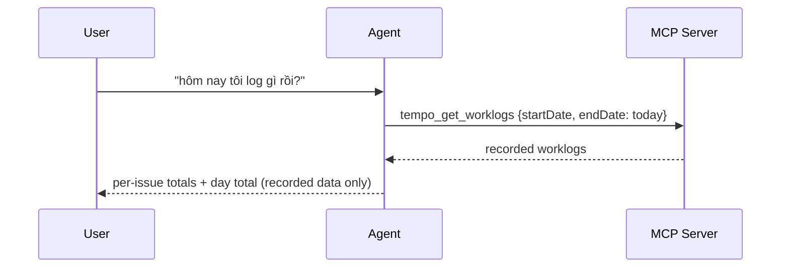

# Workflows

Concrete agent workflows for the common timesheet tasks. These mirror the
`.opencode/commands/*` and the `tempo-timesheet` skill.

## Workflow A — Daily summary



Output contract: group by issue (keys resolved via Jira when configured),
report each issue's total and the day total. Days/hours without records are
reported as "no records", never as "missing work".

## Workflow B — Log work for a Jira issue

```mermaid
sequenceDiagram
    participant U as User
    participant A as Agent
    participant S as MCP Server
    participant T as Tempo

    U->>A: "log 2h cho ABC-123 hôm nay"
    A->>S: tempo_preview_worklog (create: ABC-123, today, 120m, desc)
    S->>S: resolve issue, validate, duplicate check
    S-->>A: preview + duplicates + approvalToken
    A-->>U: preview shown; duplicates flagged; approval requested
    U-->>A: approves
    A->>S: tempo_create_worklog (same payload + token + confirm)
    S->>T: POST /worklogs
    S->>T: GET /worklogs/:id (verification)
    S-->>A: {worklog, verification}
    A-->>U: created id + verification status
```

Rules:

- Missing arguments are asked for, never guessed (especially issue keys).
- High-confidence duplicates pause the flow for a decision.
- Any user edit after preview ⇒ re-preview (the old token is dead by design).

## Workflow C — Weekly timesheet

`tempo_get_week_summary` for the week (Mon–Sun). The report contains:

- per-day totals (Mon..Sun) and per-issue totals;
- `daysWithoutRecordedWorklogs` — listed explicitly;
- a note that these are recorded figures only.

When the user asks "did I log everything?", the agent answers with the recorded
totals and the no-record days, and asks the user to classify those days
(day off / holiday / unlogged) — the server cannot know.

## Workflow D — Update an existing worklog

1. Find the worklog (`tempo_get_worklogs` for the date).
2. `tempo_preview_worklog` with `operation: "update"`, `worklogId`, `changes`.
3. Show before/after; get explicit approval.
4. `tempo_update_worklog` with same `worklogId` + `changes` + token +
   `confirm: true`.
5. Report `verification` status. On `UNCERTAIN_OUTCOME`: do not retry; re-read
   with `tempo_get_worklog` and report.

## Workflow E — Duplicate hygiene

`tempo_check_duplicate` takes a candidate entry and returns confidence-scored
matches (`high` = same issue+date+duration+description, `medium` = same
issue+date+duration, `low` = same issue+date). Use it before a busy Friday
afternoon of logging, or whenever the user suspects double-logging.
